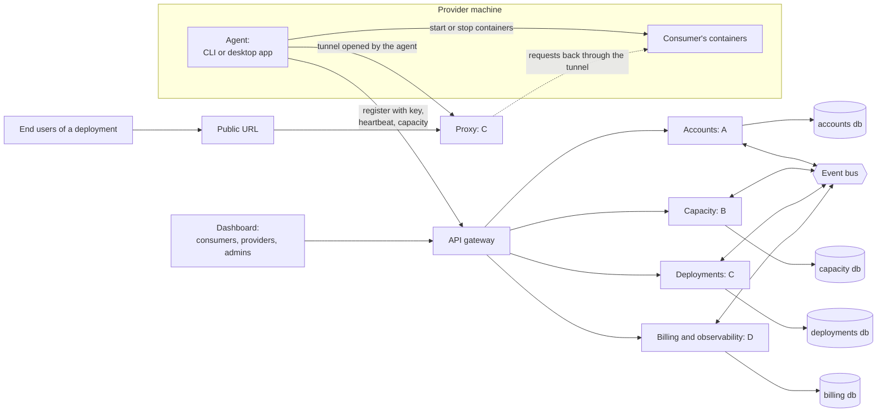

# Community Cloud: Demo Plan

Team: A, B, C, D. Four weeks to one working demo where providers share machines, consumers deploy apps on them, orgs and personal users both work, and a super admin sees everything. Everything goes through one dashboard and one API.

## Contents

1. [Demo script](#1-demo-script)
2. [Roles and accounts](#2-roles-and-accounts)
3. [Core terms](#3-core-terms)
4. [Architecture](#4-architecture)
5. [Who builds what](#5-who-builds-what)
6. [How the services talk](#6-how-the-services-talk)
7. [Validation, resilience and fraud](#7-validation-resilience-and-fraud)
8. [The dashboard](#8-the-dashboard)
9. [Four-week plan](#9-four-week-plan)
10. [Working together](#10-working-together)
11. [Repo layout](#11-repo-layout)
12. [Demo is ready when](#12-demo-is-ready-when)

## 1. Demo script

This is what we show at the end. Every task below exists to make one of these steps work.

1. Super admin logs in and sees the platform overview: all orgs, users, machines, capacity units and revenue.
2. User 1 signs up, creates the org "Acme", becomes its org admin, and invites User 2.
3. The org admin creates a provider key. On a Linux server, the CLI joins with that key. The server shows up in Acme's Capacity page, verified at 8 CU.
4. User 3, a personal user, installs the desktop app, signs in with a key, and shares 4 CU from 9:00 AM to 6:00 PM. After verification it joins the open pool.
5. User 2 switches to Acme in the top-right selector and deploys a Docker image with 2 replicas. It gets a public URL.
6. User 2 connects a GitHub repo, pushes a commit, and CI builds and redeploys it automatically.
7. We open the public URL, then watch the logs and usage update live.
8. We kill one provider machine. Traffic fails over, the replica is rescheduled, and an alert shows on the dashboard.
9. Billing page: the consumer is charged credits per minute, the provider has earned credits, and Acme sees usage per member.
10. A fake provider claims 64 CU. The benchmark measures 4, so the machine is flagged and quarantined.

## 2. Roles and accounts

| Role | Who | Can |
|---|---|---|
| Super admin | Platform team only, never part of an org | See and manage all orgs, users, machines and payouts, and quarantine machines |
| Org admin | Exactly one per org | Manage members, keys, org capacity, sharing to the public, org billing |
| Org member | Belongs to an org | Deploy on the org's capacity, see their own usage |
| Personal user | Anyone with an account | Provide capacity, consume capacity, hold their own credits |

Provider and consumer are not account types. Any org or personal user can do both. One account is personal by default and can also be a member of several orgs. The top-right selector picks the context: Personal, or one of the user's orgs.

## 3. Core terms

| Term | Meaning |
|---|---|
| Capacity unit (CU) | 1 vCPU and 1 GB RAM. A 4 CU plan means 4 vCPU and 4 GB RAM |
| Credits | Money inside the platform. Consumers spend credits per CU per minute, and providers earn them |
| Context | Personal or an org. Every API call carries it |
| Pool | The private pool is an org's machines, for its members only. The open pool is shared with everyone |
| Provider key | Created in the dashboard. The CLI or desktop app uses it to register a machine to a context |
| Deployment | A Docker image or a Git repo running as N replicas behind a public URL |
| End user | Someone using a consumer's app through its public URL. They have no account with us and never see the platform |

## 4. Architecture



The public URL is used only by end users: the people using a consumer's app, which runs on capacity shared by providers. Providers and consumers never need it to do their own work on the platform.

- A provider only shares capacity. They run the CLI on a server or the desktop app on a laptop, register the machine with a key, and set how much to share. They never deploy anything through the agent and never see a URL.
- A consumer deploys an app from the dashboard. The scheduler places its containers on one or more provider machines, and the agent on each machine starts them.
- The public URL is for the consumer's app and its end users. Requests hit our proxy, which forwards them to the right container.
- Provider machines usually sit behind home or office NAT, so the proxy can't connect to them directly. The agent opens one outbound tunnel to the proxy when it starts, and the proxy sends requests back through it. That tunnel is the only reason the agent is involved in traffic at all.

### Rules

- One API sits in front of everything. The dashboard, the CLI and the desktop app all talk to the gateway.
- Each service owns its own database. No service reads another service's database.
- Services share data in two ways: REST endpoints for queries, and events for changes. Every endpoint and event goes into `contracts/` before anyone builds against it.
- The gateway adds the user ID, the context (personal or org ID) and the role to every request.

### Strategy pattern at the core

| Strategy | Implementations | Chosen by | Owner |
|---|---|---|---|
| ContextStrategy | PersonalContext, OrgContext | The top-right selector. Decides the pool, who pays, and what's allowed | A |
| ProviderStrategy | CliProvider (server, always on), DesktopProvider (sharing hours, idle and battery rules, can vanish) | Agent type at registration | B |
| PlacementStrategy | PrivatePool (with a tenant check), OpenPool | Context | C |
| PricingStrategy | OrgPricing (the org pays, usage per member), PersonalPricing (the user's own credits) | Context | D |

```ts
interface PlacementStrategy {
  pickMachines(request: CapacityRequest, replicas: number): Promise<Machine[]>
}
```

Adding a new case later, like org servers shared to the public, means adding a strategy, not editing every service. The strategies live in the core package, and the api modules only call their interfaces.

### Suggested stack

Decide on day 1 and keep it simple.

| Piece | Choice |
|---|---|
| Services | TypeScript with NestJS |
| Databases | One Postgres server with four separate databases |
| Events | Redis Streams or NATS |
| Dashboard | Next.js |
| Agent | Go, one binary for the CLI, wrapped with Tauri for the desktop app |
| Workloads on providers | Docker |
| Public URLs | Caddy or Traefik as the proxy, Cloudflare wildcard DNS and TLS in front |
| Logs and metrics | Grafana, Loki, Prometheus |
| Payments | Stripe in test mode |
| CI | GitHub Actions for our repos, a small builder service for users' repos |

## 5. Who builds what

### A: Accounts, orgs and the dashboard shell

- **Owns:** sign up and login, users, orgs, the one-admin-per-org rule, members and invites, roles, provider keys, the context selector, the super admin panel, auth at the gateway.
- **Database:** accounts.
- **Endpoints:** `POST /auth/signup`, `POST /auth/login`, `GET /me` (the user's contexts), `POST /orgs`, `POST /orgs/:id/invites`, `GET /orgs/:id/members`, `POST /keys`, `POST /keys/verify` (used by B), `GET /contexts/:id` (used by everyone).
- **Events out:** `user.created`, `org.created`, `member.added`, `key.created`, `key.revoked`.
- **Dashboard:** the layout, the top-right selector, Login, Members, Keys, Super admin.
- **Strategy:** ContextStrategy.

### B: Capacity and providers

- **Owns:** the Go agent core, the CLI, the desktop app wrapper, machine registration with a key, heartbeats, CU per machine, sharing settings (how much, which hours), verification (a benchmark on join, spot checks, trust score, quarantine), and capacity planning (available, reserved and used per pool).
- **Database:** capacity.
- **Endpoints:** `POST /machines/register` (with a key), `POST /machines/:id/heartbeat`, `PUT /machines/:id/sharing`, `GET /machines?context=`, `GET /pools/:context/capacity`, `POST /capacity/reserve` and `POST /capacity/release` (used by C).
- **Events out:** `machine.online`, `machine.offline`, `machine.verified`, `machine.quarantined`, `capacity.changed`.
- **Dashboard:** Capacity and Sharing pages.
- **Strategy:** ProviderStrategy.

### C: Deployments, scheduling and public URLs

- **Owns:** the deployment API (from a Docker image or a Git repo), a builder for Git repos (CI/CD through a GitHub webhook), the scheduler, replicas, health checks, failover and rescheduling, the proxy and agent tunnel for public URLs, and deployment logs.
- **Database:** deployments.
- **Endpoints:** `POST /deployments`, `GET /deployments/:id`, `POST /deployments/:id/scale`, `POST /deployments/:id/redeploy`, `POST /webhooks/github`, `GET /deployments/:id/logs`.
- **Events out:** `deployment.created`, `replica.started`, `replica.stopped`, `deployment.failed`.
- **Events in:** `machine.offline` (triggers a reschedule).
- **Dashboard:** Deployments page: create, public URL, replicas, connect a repo, logs tab.
- **Strategy:** PlacementStrategy.
- **Pairs with B in week 2:** B's agent runs containers and holds the tunnel. C defines that contract and runs the proxy.

### D: Billing, usage and observability

- **Owns:** pricing per CU per minute, a double-entry credits ledger, charges from usage, provider earnings, top-ups through Stripe test mode, org usage per member, logs and metrics for every service, alerts, and the health views on the dashboard.
- **Database:** billing, plus Loki and Prometheus.
- **Endpoints:** `GET /balance?context=`, `POST /credits/hold` (used by C before deploying), `POST /topup`, `GET /usage?context=&by=member`, `GET /earnings?context=`.
- **Events in:** `replica.started`, `replica.stopped`, `machine.online`, `machine.offline`. D works out usage from these itself, so nobody has to report usage separately.
- **Events out:** `charge.created`, `credits.low`, `earning.created`.
- **Dashboard:** Usage and Billing pages, monitoring widgets on Overview, revenue on Super admin.
- **Strategy:** PricingStrategy.

## 6. How the services talk

| From | To | Call or event | Why |
|---|---|---|---|
| CLI, desktop app | B | `POST /machines/register` with a key | A machine joins |
| B | A | `POST /keys/verify` | Check the key and find its context |
| C | B | `POST /capacity/reserve` | Hold CU before placing replicas |
| C | D | `POST /credits/hold` | Make sure the consumer can pay |
| B | everyone | `machine.offline` | C reschedules, D stops charging |
| C | D | `replica.started`, `replica.stopped` | Usage and charges |
| D | C | `credits.low` | Warn the user, then scale to zero after a grace period |
| Any service | A | `GET /contexts/:id` | Who is calling, which org, which role |

## 7. Validation, resilience and fraud

| Concern | What we do | Owner |
|---|---|---|
| Input validation | Validate request bodies at the gateway and in each service, and reject unknown fields | Everyone |
| Capacity is real | The agent benchmarks CPU, RAM, disk and network on join. Only measured CU counts, not claimed CU | B |
| Fraud | Random spot-check jobs with known answers, heartbeat consistency checks, one machine ID per hardware fingerprint, a trust score, quarantine with payouts on hold | B, D |
| Overcommit | Reserve CU before scheduling, and never place more than the verified CU | B, C |
| Fault tolerance | Open pool deployments always run 2 or more replicas on different providers. Health checks run every few seconds, and lost replicas are rescheduled within a minute | C |
| Calls between services | Timeouts, retries with backoff only on idempotent calls, idempotency keys on holds and charges, an outbox for events | Everyone, D for charges |
| Capacity planning | Available, reserved and used CU per pool. Alert under 20% headroom, and reject deployments that don't fit | B, D |
| Monitoring | Grafana dashboards per service, alerts on errors, machine churn and low credits | D |
| Logs | Service logs and deployment logs in one place, searchable by request ID and by deployment | D, C |

## 8. The dashboard

One app with one layout. The top right holds the context selector (Personal or an org) and the user menu. Everything on the page follows the selected context.

| Page | Shows | Owner | Who sees it |
|---|---|---|---|
| Overview | CU in use, live deployments, balance, alerts | D | Everyone |
| Capacity | As a provider: my machines, verified CU, status. As a consumer: CU available to me | B | Everyone |
| Sharing | How much to share, which hours, private or open pool | B | Providers. In an org, the org admin only |
| Deployments | Create from an image or a repo, public URL, replicas, CI/CD, logs | C | Everyone |
| Usage | What is being used, by deployment, and by member in an org | D | Everyone. Per-member view for the org admin |
| Billing | Credits, charges, earnings, top-up | D | Personal users and org admins |
| Members | Invite, remove, roles | A | Org admin |
| Keys | Create and revoke provider keys | A | Personal users and org admins |
| Super admin | All orgs, users, machines, quarantine, revenue | A, with B and D widgets | Super admin |

## 9. Four-week plan

Friday of each week is integration day, where everything joins up and we run the demo so far.

| Person | Week 1 | Week 2 | Week 3 | Week 4 |
|---|---|---|---|---|
| A | Contracts. Auth, orgs, contexts, gateway, dashboard layout and selector | Invites, members, keys, key verify | Super admin panel, role checks on every endpoint | Seed script for the demo accounts, polish |
| B | Contracts. Agent core: register with a key, heartbeat, CU report | CLI, run containers on request from C, sharing settings | Desktop app wrapper, benchmark verification, capacity reserve and release | Spot checks, trust score, quarantine, capacity planning view |
| C | Contracts. Deployments API, deploy a Docker image to one machine against fake capacity | Public URL through the proxy and tunnel, replicas, health checks | Failover on `machine.offline`, GitHub webhook build and redeploy | Deployment logs, scaling, polish |
| D | Contracts. Ledger, CU pricing, balances, logging stack | Usage from events, per-minute charges, Stripe test top-up | Provider earnings, org usage per member, `credits.low` | Grafana dashboards, alerts, super admin revenue |

## 10. Working together

- **Day 1:** each person writes their endpoints and events in `contracts/` and reviews everyone else's. Run mock servers from the OpenAPI files, with Prism for example, so nobody waits on anybody.
- **After day 1:** a contract changes only through a pull request that the consuming person approves.
- **Daily standup in Slack:**

  ```
  Done yesterday:
  Doing today:
  Blocked by:
  ```

- **Every service has:** a `/health` endpoint, structured JSON logs with a request ID, a Dockerfile, CI, and a README that explains how to run it alone.
- **Done means:** it works against the real services on Friday, it has tests, and its docs are updated.

## 11. Repo layout

Eight repos. Items marked later are out of scope this week.

| Repo | What lives there | This week | Owner |
|---|---|---|---|
| [contracts](https://github.com/devweekends/meshly-cloud-contracts) | OpenAPI per service, event definitions, and the shared types generated from them for api, web, cli and desktop | Yes | Everyone, each person their own part |
| [api](https://github.com/devweekends/meshly-cloud-api) | The one API: the gateway, the four service modules (accounts, capacity, deployments, billing) each with its own database, the proxy for public URLs, docker-compose and the monitoring setup | Yes | A, B, C and D, each their own module. C owns the proxy, D the monitoring setup |
| [core](https://github.com/devweekends/meshly-cloud-core) | Package the api uses. Strategy now: context, provider, placement and pricing. Scheduler later | Strategy yes, scheduler later | Each person owns their strategy: A context, B provider, C placement, D pricing |
| [packages](https://github.com/devweekends/meshly-cloud-packages) | cli now: the agent that registers with a key, sends heartbeats, runs containers and opens the tunnel. sdk later. mcp later | cli yes, sdk and mcp later | B |
| [desktop](https://github.com/devweekends/meshly-cloud-desktop) | Desktop app for providers. It wraps the same agent as the cli, so agent logic is written once | Yes, from week 3 | B |
| [web](https://github.com/devweekends/meshly-cloud-web) | The one dashboard, with the org selector top right | Yes | A owns the layout and selector, each person owns their own pages |
| [docs](https://github.com/devweekends/meshly-cloud-docs) | Docs site: overview, how to use the contracts, a page per module, runbooks, the demo script | Yes | Everyone writes, A keeps it tidy |
| [application](https://github.com/devweekends/meshly-cloud-apps) | Later, contributors only: one-click templates for databases, storage and apps such as WordPress | Later | Community contributors |

How the repos depend on each other:

- contracts depends on nothing. Every other repo builds against it.
- api depends on contracts and core.
- web, cli and desktop depend only on contracts, and talk to api over HTTP.
- desktop reuses the agent code from `packages/cli`.

Until the scheduler package exists, placement is C's simple strategy in core: pick the first machine in the right pool with enough free verified CU, and spread replicas across different providers.

## 12. Demo is ready when

- [ ] All 10 steps of the demo script run end to end without manual fixes
- [ ] The context selector changes every page correctly
- [ ] A server joins with the CLI and a desktop joins with the app, both with a key
- [ ] A deployment from a Docker image and one from a Git repo both get a public URL
- [ ] Killing a machine fails over with no visible downtime on a 2-replica deployment
- [ ] Credits move correctly between consumer and provider, and the ledger balances
- [ ] The fake 64 CU machine is caught and quarantined
- [ ] Logs and metrics for every service are visible in one place
