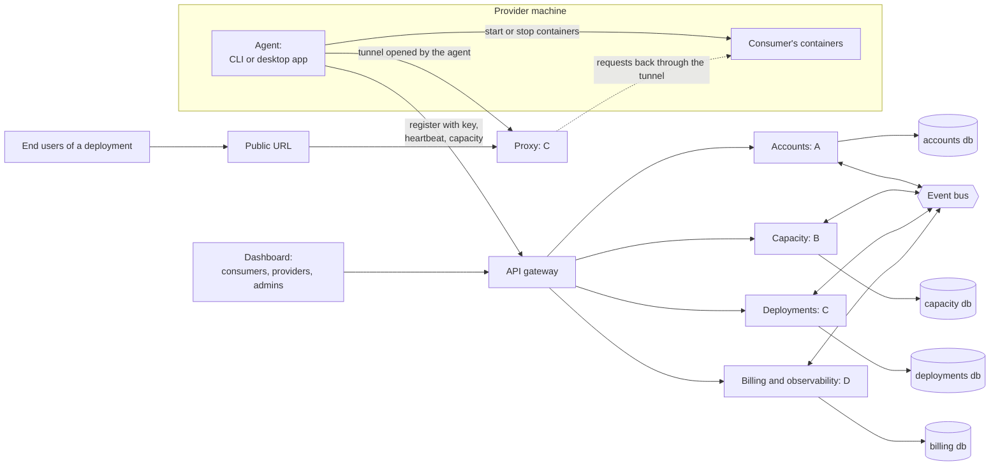

# Architecture



## Who uses the public URL

The public URL is used only by end users: the people using a consumer's app, which runs on capacity shared by providers. Providers and consumers never need it to do their own work on the platform.

- A provider only shares capacity. They run the CLI on a server or the desktop app on a laptop, register the machine with a key, and set how much to share. They never deploy anything through the agent and never see a URL.
- A consumer deploys an app from the dashboard. The scheduler places its containers on one or more provider machines, and the agent on each machine starts them.
- The public URL is for the consumer's app and its end users. Requests hit our proxy, which forwards them to the right container.
- Provider machines usually sit behind home or office NAT, so the proxy can't connect to them directly. The agent opens one outbound tunnel to the proxy when it starts, and the proxy sends requests back through it. That tunnel is the only reason the agent is involved in traffic at all.

## Rules

- One API sits in front of everything. The dashboard, the CLI and the desktop app all talk to the gateway.
- Each service owns its own database. No service reads another service's database.
- Services share data in two ways: REST endpoints for queries, and events for changes. Every endpoint and event goes into [contracts](https://github.com/devweekends/meshly-cloud-contracts) before anyone builds against it.
- The gateway adds the user ID, the context (personal or org ID) and the role to every request.

## Strategy pattern at the core

| Strategy | Implementations | Chosen by | Owner |
|---|---|---|---|
| ContextStrategy | PersonalContext, OrgContext | The top-right selector. Decides the pool, who pays, and what's allowed | A |
| ProviderStrategy | CliProvider (server, always on), DesktopProvider (sharing hours, idle and battery rules, can vanish) | Agent type at registration | B |
| PlacementStrategy | PrivatePool (with a tenant check), OpenPool | Context | C |
| PricingStrategy | OrgPricing (the org pays, usage per member), PersonalPricing (the user's own credits) | Context | D |

```ts
interface PlacementStrategy {
  pickMachines(request: CapacityRequest, replicas: number): Promise<Machine[]>
}
```

Adding a new case later, like org servers shared to the public, means adding a strategy, not editing every service. The strategies live in the [core](https://github.com/devweekends/meshly-cloud-core) package, and the api modules only call their interfaces.

Until the scheduler package exists, placement is C's simple strategy in core: pick the first machine in the right pool with enough free verified CU, and spread replicas across different providers.

Next: [Services](services.md)
